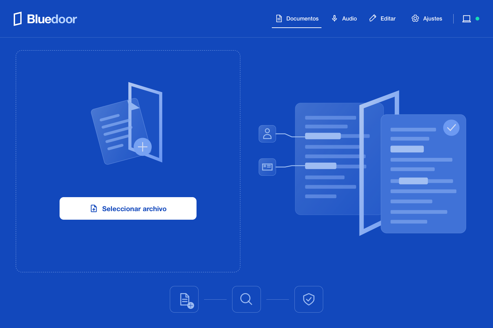

# BlueDoor

<p align="center">
  
</p>

**Una capa de preparación local para el trabajo legal con IA.**

Aplicación de escritorio para preparar documentos legales y transcripciones en tu propio equipo: análisis local de información sensible, alias revisables, edición enriquecida, exportación PDF y un Vault cifrado para lo que quieres conservar.

<p align="center">
  
</p>

Proyecto independiente de escritorio, con datos y preferencias propios. Repositorio de desarrollo: [VodoooFilms/BlueDoor](https://github.com/VodoooFilms/BlueDoor). Presentación del producto: [BlueDoor en Prompthea](https://www.prompthea.com/projects/bluedoor).

La interfaz sigue la referencia BlueDoor: fondo azul intenso, marca de puerta y navegación blancas, ilustraciones SVG azul claro al 80 % y botones principales blancos con texto azul. Las pantallas de documentos, audio, ajustes, modelos, edición y mapa privado comparten la misma identidad. Los documentos conservan su contenido y formato, con hoja blanca y tinta legible.

## Desarrollo

```sh
pnpm install --frozen-lockfile
pnpm dev
# Aplicación nativa (requiere toolchain Rust/Xcode y runtime local)
pnpm tauri dev
```

## Verificación

```sh
pnpm typecheck
pnpm build
pnpm test:native
pnpm check:native
pnpm test:ui
pnpm test:brand:ui
pnpm test:workspace:ui
pnpm test:layout:ui
pnpm test:vault:ui
```

## Compilación macOS

`pnpm release:mac:dev` crea una compilación de desarrollo con firma ad hoc. `pnpm release:mac` requiere identidad de distribución y notarización configuradas. Se generó e instaló la compilación local de desarrollo 0.4.0 en `/Applications/BlueDoor.app`; no se publicó. La instalación independiente requiere descargar sus modelos desde Ajustes.

## Identidad y datos

- Aplicación: **BlueDoor**, identificador `com.bluedoor.desktop`.
- Idioma inicial: inglés; Ajustes permite cambiar a español y conserva la elección.
- Historial y modelos: directorio de datos propio de Tauri; en macOS `~/Library/Application Support/com.bluedoor.desktop/`.
- Las preferencias y la primera bienvenida usan claves propias. No se copian documentos, historial ni modelos personales de Belegal o Local Legal.
- El Vault cifra documentos, transcripciones y originales en reposo con una contraseña y una frase de recuperación. Su modelo de amenaza y sus límites están en [docs/VAULT_2026-10-23.md](docs/VAULT_2026-10-23.md).
- Se conservan los identificadores y hashes de los modelos existentes (incluido `belegal-pii-v1`) para no alterar la compatibilidad de sus artefactos.
- Marca SVG e iconos editables en `src/assets/` y `assets/branding/`.

Los documentos en `docs/archive/` y `docs/milestones/` son antecedentes históricos de la base. La licencia y los avisos originales se conservan. Véanse [PRIVACY.md](PRIVACY.md), [THIRD_PARTY_NOTICES.md](THIRD_PARTY_NOTICES.md) y [docs/BLUEDOOR_FORK.md](docs/BLUEDOOR_FORK.md).

## Estado y límites

- Desarrollo y demostraciones privadas en Mac con Apple Silicon; no hay instalador público.
- La detección puede omitir información. Revisar el mapa privado y las páginas antes de compartir; no se garantiza anonimato.
- **Send to GPT** abre ChatGPT en el navegador. No sube ni adjunta el documento; la carga del PDF exportado es manual.
- El chequeo del 17 de octubre de 2026 pasó tipos, build, Clippy y suites de UI; 104 pruebas nativas aprobadas y 15 omitidas. Véase [el informe](docs/AUDIT_2026-10-17.md) para el alcance.
- Antes de distribuir: completar los textos de licencia pendientes, firma Developer ID, notarización y prueba en un Mac limpio.
- Modelos, instaladores, documentos personales y resultados de QA se mantienen fuera de Git.
